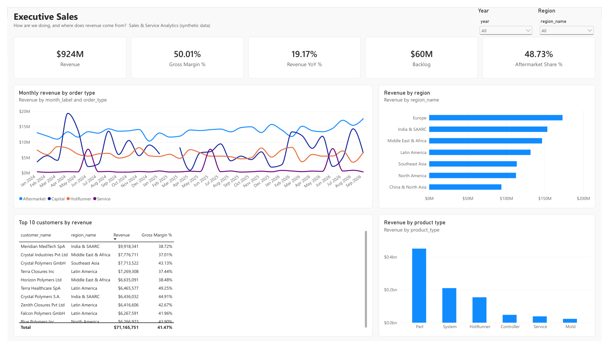
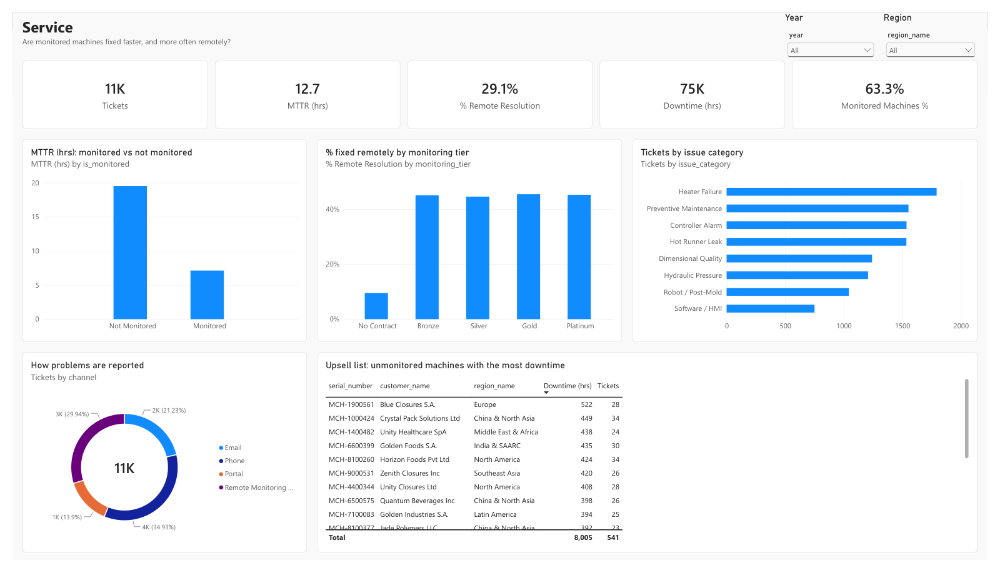
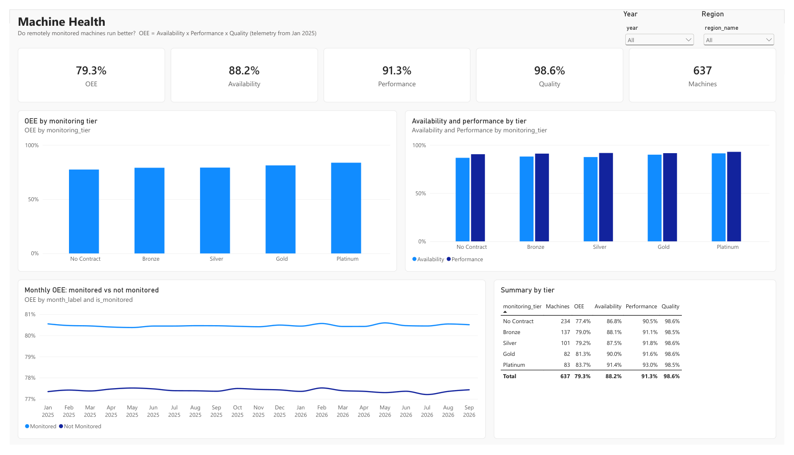
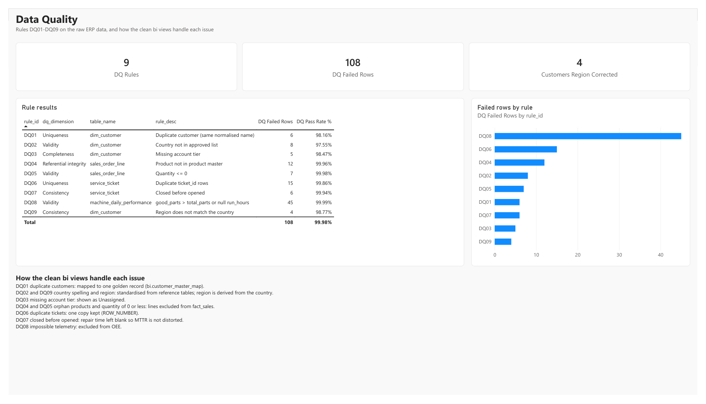

# Sales & Service Analytics: an end-to-end BI portfolio project

An end-to-end business-intelligence project for a fictional global maker of
injection-molding machines, molds and hot runners. The company earns money three
ways: selling machines (capital), selling spare parts (aftermarket), and a
remote-monitoring service for machines already installed at customer plants.

The project covers what an enterprise BI and business-analysis team does:
profile ERP data, turn the problems into data-quality rules, build a clean star
schema, model KPIs in Power BI with DAX and row-level security, and document the
requirements. **All data is synthetic** (generated by
`scripts/generate_data.py`); built with AI-assisted scaffolding, with every
query, measure and design decision documented.

## The business story in the data

```
+------------------------------------+---------------------------------------+
| Finding                            | Evidence                              |
+====================================+=======================================+
| Monitored machines run better      | OEE 83.7% on the Platinum tier vs     |
|                                    | 77.4% with no monitoring contract     |
+------------------------------------+---------------------------------------+
| They are repaired faster           | MTTR 7.1 h monitored vs 19.5 h not    |
|                                    | monitored                             |
+------------------------------------+---------------------------------------+
| Mostly without a site visit        | 45% of tickets fixed remotely vs 10%  |
+------------------------------------+---------------------------------------+
| Aftermarket is the steady engine   | 48.7% of revenue, growing about 7-8%  |
|                                    | a year; capital sales are lumpy       |
+------------------------------------+---------------------------------------+
| So: sell more monitoring contracts | An upsell list ranks unmonitored      |
|                                    | machines by downtime                  |
+------------------------------------+---------------------------------------+
```

## How it is built

```
ERP and telemetry extracts (8 CSV files)
  |
  v
SQL Server, schema raw ......... data exactly as loaded, problems included
  |  sql/03  profiling
  |  sql/04  9 data-quality rules + reference data
  v
SQL Server, schema bi .......... clean star-schema views (3 facts, 5 dimensions)
  |
  v
Power BI ....................... 24 DAX measures, 4 report pages, RLS by region
  |
  v
Git ............................ SQL, docs and the Power BI project as text
```

## Report pages

### Executive Sales



### Service



### Machine Health



### Data Quality



```
+------------------+---------------------------------------------------------+
| Page             | Question it answers                                     |
+==================+=========================================================+
| Executive Sales  | How are we doing, and where does revenue come from?     |
+------------------+---------------------------------------------------------+
| Service          | Are monitored machines fixed faster, and more often     |
|                  | remotely?                                               |
+------------------+---------------------------------------------------------+
| Machine Health   | Do monitored machines run better (OEE by monitoring     |
|                  | tier)?                                                  |
+------------------+---------------------------------------------------------+
| Data Quality     | Can the numbers be trusted? Rule results and how each   |
|                  | issue is handled                                        |
+------------------+---------------------------------------------------------+
```

## Data-quality rules

Found by profiling the raw data first (see `docs/profiling_notes.md` and
`docs/query_log.md`), then automated in `sql/04`.

```
+------+--------------------------------+------+------------------------------+
| Rule | Issue                          | Rows | Handled in the clean layer   |
|      |                                |      | by                           |
+======+================================+======+==============================+
| DQ01 | Same customer entered twice    |    6 | Golden-record mapping        |
+------+--------------------------------+------+------------------------------+
| DQ02 | Country spelled non-standard   |    8 | Reference table of countries |
+------+--------------------------------+------+------------------------------+
| DQ03 | Account tier missing           |    5 | Shown as Unassigned          |
+------+--------------------------------+------+------------------------------+
| DQ04 | Order line with unknown        |   12 | Excluded from sales          |
|      | product                        |      |                              |
+------+--------------------------------+------+------------------------------+
| DQ05 | Quantity of 0 or less          |    7 | Excluded from sales          |
+------+--------------------------------+------+------------------------------+
| DQ06 | Ticket appears twice           |   15 | One copy kept (ROW_NUMBER)   |
+------+--------------------------------+------+------------------------------+
| DQ07 | Ticket closed before opened    |    6 | Repair time left blank       |
+------+--------------------------------+------+------------------------------+
| DQ08 | Impossible telemetry           |   45 | Excluded from OEE            |
+------+--------------------------------+------+------------------------------+
| DQ09 | Region does not match country  |    4 | Region derived from country  |
+------+--------------------------------+------+------------------------------+
```

## Repository

```
+-----------------------------+----------------------------------------------+
| Path                        | Contents                                     |
+=============================+==============================================+
| data/                       | 8 synthetic CSV extracts (customers,         |
|                             | products, machines, orders, order lines,     |
|                             | tickets, daily telemetry, regions)           |
+-----------------------------+----------------------------------------------+
| scripts/generate_data.py    | Generates the data (fixed seed, so it is     |
|                             | reproducible)                                |
+-----------------------------+----------------------------------------------+
| sql/01-02                   | Create the database and load the CSVs        |
+-----------------------------+----------------------------------------------+
| sql/03                      | Data profiling queries                       |
+-----------------------------+----------------------------------------------+
| sql/04                      | Data-quality rules view + country reference  |
|                             | tables                                       |
+-----------------------------+----------------------------------------------+
| sql/05                      | Clean star-schema views for Power BI         |
+-----------------------------+----------------------------------------------+
| sql/06                      | Business questions with window functions,    |
|                             | CTEs and index tuning                        |
+-----------------------------+----------------------------------------------+
| powerbi/SalesServiceBI.pbip | Power BI project: model as TMDL text, report |
|                             | as JSON                                      |
+-----------------------------+----------------------------------------------+
| powerbi/SalesServiceBI.pbix | The same report with the data inside: opens  |
|                             | in Power BI Desktop without SQL Server       |
+-----------------------------+----------------------------------------------+
| docs/requirements_spec.md   | Personas, user stories, KPI definitions      |
+-----------------------------+----------------------------------------------+
| docs/data_dictionary.md     | Every table and column in plain English      |
+-----------------------------+----------------------------------------------+
| docs/profiling_notes.md     | What profiling found, and why it matters     |
+-----------------------------+----------------------------------------------+
| docs/query_log.md           | Every analysis query with its result and     |
|                             | conclusion                                   |
+-----------------------------+----------------------------------------------+
| docs/performance_notes.md   | Model size by column, query timings, and the |
|                             | tuning findings they led to                  |
+-----------------------------+----------------------------------------------+
```

## Skills demonstrated

```
+--------------------------------+-------------------------------------------+
| Skill                          | Where                                     |
+================================+===========================================+
| Data profiling and analysis    | sql/03, docs/profiling_notes.md,          |
|                                | docs/query_log.md                         |
+--------------------------------+-------------------------------------------+
| Data-quality metrics           | sql/04 rules view, Data Quality page      |
+--------------------------------+-------------------------------------------+
| Master data management         | Golden-record customer mapping, country   |
|                                | reference data                            |
+--------------------------------+-------------------------------------------+
| Advanced SQL                   | Window functions, CTEs, sargable filters, |
|                                | index vs columnstore tuning (sql/06)      |
+--------------------------------+-------------------------------------------+
| Dimensional modelling          | Star schema views (sql/05), Power BI      |
|                                | relationships                             |
+--------------------------------+-------------------------------------------+
| DAX and Power BI               | 24 measures incl. YoY, YTD,               |
|                                | USERELATIONSHIP, OEE, MTTR                |
+--------------------------------+-------------------------------------------+
| Tabular model best practice    | Best Practice Analyzer (Tabular Editor):  |
|                                | 228 findings to 52; descriptions, display |
|                                | folders; .pbix 11 MB to 5.5 MB            |
+--------------------------------+-------------------------------------------+
| Performance tuning             | VertiPaq Analyzer and Server Timings (DAX |
|                                | Studio): found 20% of the model was       |
|                                | redundant columns                         |
|                                | (docs/performance_notes.md)               |
+--------------------------------+-------------------------------------------+
| Security                       | Row-level security, one role per region   |
+--------------------------------+-------------------------------------------+
| Requirements and documentation | docs/requirements_spec.md, data           |
|                                | dictionary                                |
+--------------------------------+-------------------------------------------+
| Version control                | Git, Power BI project (.pbip) as text     |
+--------------------------------+-------------------------------------------+
```

## Run it yourself

- Install SQL Server Developer edition and SSMS (both free).
- Copy the `data` folder to `C:\SalesServiceBI\data\` (or change `@path` at the
  top of `sql/02`).
- In SSMS run `sql/01`, `02`, `04`, `05` in that order.
- Open `powerbi/SalesServiceBI.pbip` in Power BI Desktop and refresh. Or just
  open `SalesServiceBI.pbix`, which already contains the data.

Expected after loading: 326 customers (320 after de-duplication), 637 machines,
30,775 order lines (30,101 clean), 10,677 tickets (10,662 clean), 382,639
machine-days (382,594 clean).

### Regenerate the data

```
py -m venv .venv
.venv\Scripts\python -m pip install -r requirements.txt
.venv\Scripts\python scripts\generate_data.py
```

The CSVs use LF line endings (kept by `.gitattributes`); don't re-save them in
Excel.
